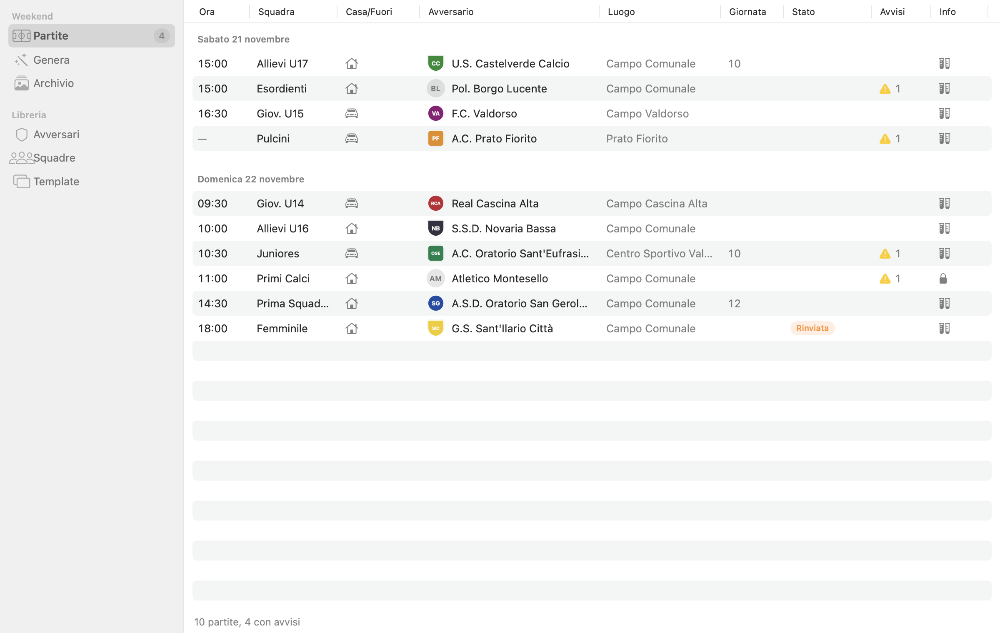

# Sergnanese Social

App per Mac (macOS 15 o successivo, chip Apple) che genera le immagini Instagram e Facebook delle partite del weekend
della società. Si sceglie il weekend, si controllano le partite, si genera: l'app crea i PNG dai modelli HTML,
pronti da condividere con AirDrop.



## Scaricare l'app

Scarica l'ultimo `.dmg` dalla pagina [Releases](https://github.com/fabiobosioit/sergnanese-social/releases).
I passaggi di installazione e del primo avvio (macOS blocca le app non notarizzate) sono in
[docs/INSTALL.md](docs/INSTALL.md).

## Documentazione

- [Guida per l'utente](docs/USER-GUIDE.md): la routine del weekend, le scorciatoie, i backup, le domande frequenti.
- [Scrivere un template](docs/TEMPLATES.md): il formato dei modelli HTML e come farne disegnare uno nuovo.
- [Installare](docs/INSTALL.md): download, primo avvio, aggiornamenti, disinstallazione.

## Compilare dal codice sorgente

Serve solo il Mac con i Command Line Tools di Apple (non serve Xcode).

```sh
Scripts/run.sh          # compila, crea un'app di sviluppo e la avvia (cartella dati "Sergnanese Social Dev")
Scripts/run.sh --mock   # avvia l'app con dati finti in memoria
Scripts/check.sh        # compilazione con avvisi come errori, controllo del formato, test
```

Gli altri comandi (`swift run ss-tool …`) sono elencati in `CLAUDE.md`.

## Licenze e materiali di terze parti

- I loghi di prova in `Resources/Seed` e `Resources/Fixtures` sono inventati e generati dal codice
  (`make_logos.swift`). Non vanno committati loghi reali di altre società: restano dei rispettivi proprietari.
- I font Barlow e Barlow Condensed sono distribuiti con licenza SIL Open Font License 1.1; il testo della licenza
  è in `Resources/Templates/*/assets/fonts/OFL.txt`.
