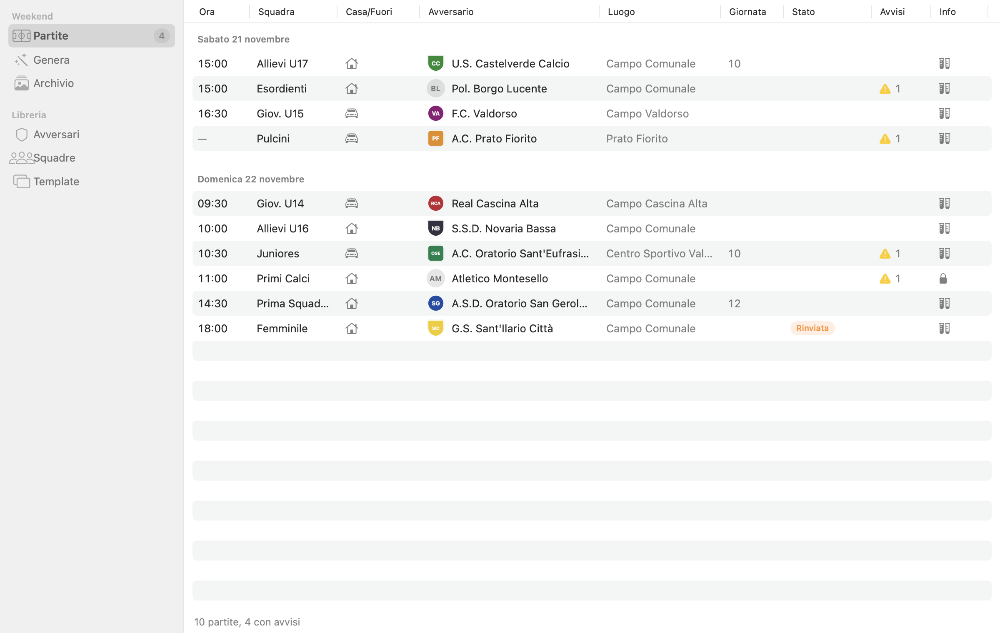
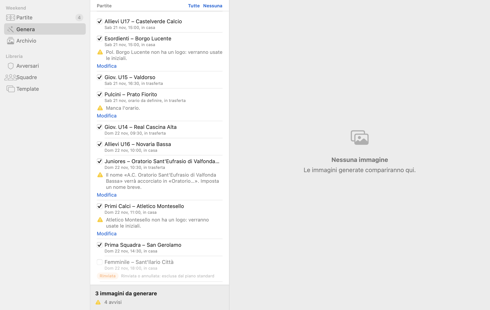
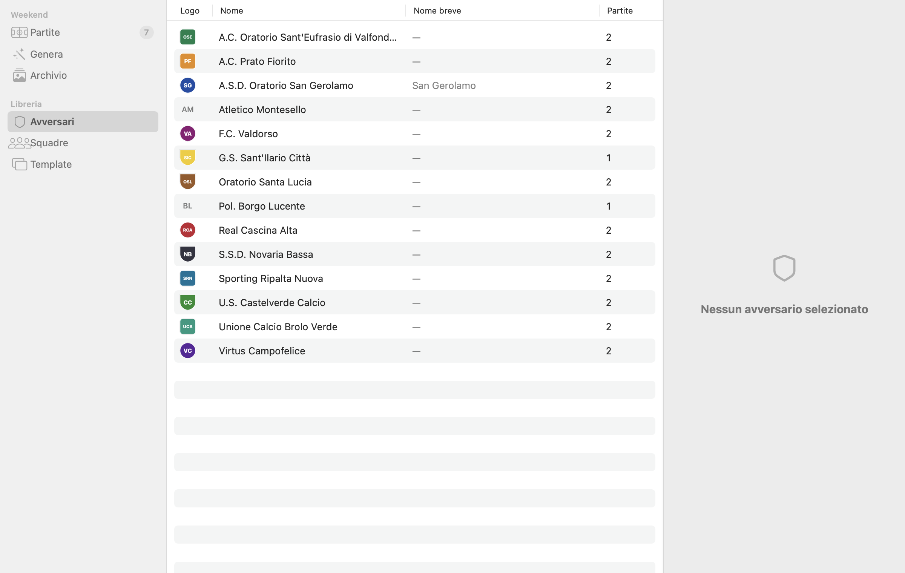
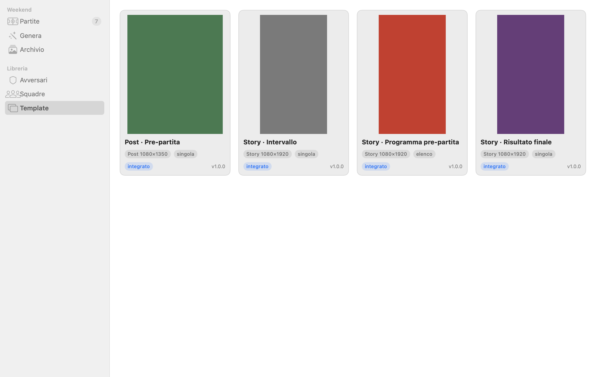
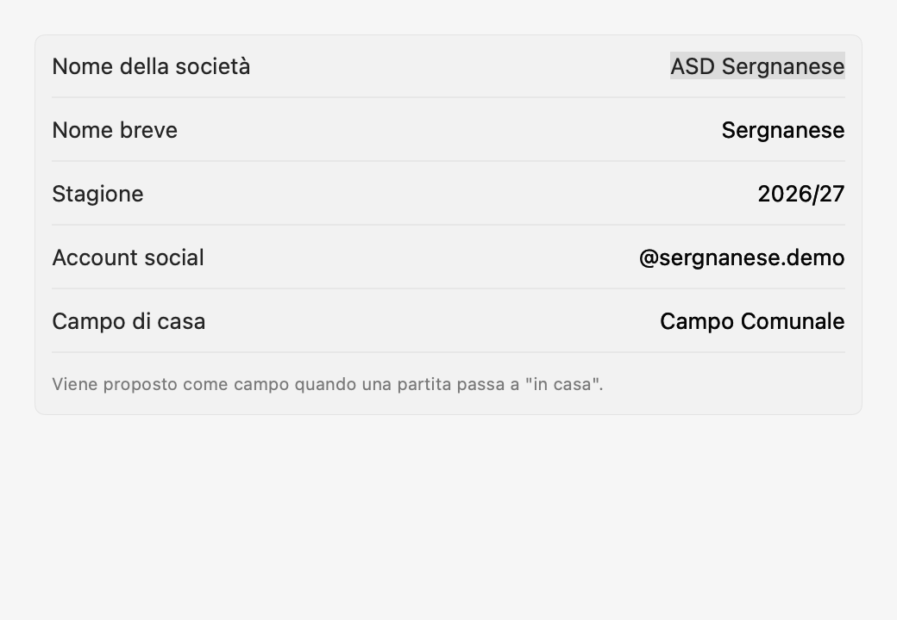

# Guida per l'utente di Sergnanese Social

Questa guida spiega come preparare le immagini delle partite del weekend. Per installare l'app vedi
[INSTALL.md](INSTALL.md); per scrivere un modello vedi [TEMPLATES.md](TEMPLATES.md).

Le schermate sono prese dall'app con dati di prova inventati.

## Com'è fatta l'app

La finestra principale ha una barra laterale a sinistra, divisa in due gruppi.

| Gruppo | Sezione | A cosa serve |
|---|---|---|
| **Weekend** | Partite | Le partite del weekend selezionato. Il badge indica quante hanno avvisi. |
| | Genera | Sceglie partite e modelli e produce le immagini. |
| | Archivio | Tutte le immagini già generate, raggruppate per weekend. |
| **Libreria** | Avversari | Le squadre avversarie, con nome breve e logo. |
| | Squadre | Le squadre della società (per esempio Prima Squadra, Juniores). |
| | Template | I modelli con cui si generano le immagini. |

Le impostazioni della società si aprono dal menu **Sergnanese Social › Impostazioni…** (⌘,).

## La routine del weekend

Di solito bastano sei passaggi, una volta a settimana.

### 1. Scegli il weekend e controlla le partite

Apri **Partite**. In alto c'è il selettore del weekend: le frecce ‹ › (oppure ⌘[ e ⌘]) passano al weekend
precedente o successivo, **Questo weekend** (⌘T) torna a quello in corso.

Per aggiungere una partita premi **Aggiungi** (+) nella barra oppure ⌘N. Nella scheda compila:

- **Squadra** (una delle tue squadre) e **Avversario**;
- **Data** e **Orario** (per esempio `15:30`);
- **Campo** (in casa o in trasferta) e **Luogo**;
- **Giornata**, se la conosci.

Una partita cade nel weekend della sua data: se cambi la data, la partita passa al weekend corrispondente.

### 2. Sistema gli avvisi

Una partita con un problema ha un triangolo giallo **Avviso** con la spiegazione. Gli avvisi più comuni sono:

- il nome dell'avversario è troppo lungo e verrà accorciato;
- manca il logo dell'avversario (al suo posto compaiono le iniziali);
- manca l'orario.

Dove possibile, l'avviso ha un pulsante per correggerlo in un passaggio. Gli avvisi non bloccano la generazione, ma è meglio risolverli prima.

Per la correzione dei nomi e dei loghi vedi [Avversari e loghi](#avversari-e-loghi).

### 3. Scegli cosa generare

Apri **Genera**. Ci sono due elenchi:

- **Partite**: spunta le partite da includere. **Tutte** e **Nessuna** selezionano o deselezionano tutto.
- **Template**: spunta i modelli da usare, per esempio il Post pre-partita e la Story del programma.

In fondo il riepilogo indica quante immagini verranno create, per esempio `3 immagini da generare`, e quanti avvisi restano.
Se non c'è nessuna partita o nessun modello selezionato, il pulsante è disattivato e il motivo è scritto sopra.

Partite rinviate o annullate restano nell'elenco ma sono escluse dal piano standard.

### 4. Genera le immagini

Premi **Genera immagini** oppure ⌘R (o **Immagini › Genera immagini del weekend**).
Una barra di avanzamento mostra `Immagine 4 di 12`. Puoi annullare con **Annulla**: le immagini già pronte restano.

Al termine compare la sezione **Risultato** con le immagini create. Se qualcuna non è riuscita, l'app lo dice
e puoi premere **Rigenera** su quella immagine.

### 5. Controlla il risultato

Clicca un'immagine e premi **Spazio** (oppure **Invio**, o ⌘Y) per aprire l'**Anteprima rapida**, un pannello con l'immagine ingrandita.
Con ⇧ o ⌘ puoi selezionarne più d'una. Con le frecce ti sposti tra le immagini.

Controlla in particolare:

- il nome dell'avversario, intero e leggibile;
- il logo, o le iniziali se il logo manca;
- orario, campo e risultato, se la partita è già giocata.

Se qualcosa non va, torna in **Partite**, correggi il dato e genera di nuovo solo quella partita.

### 6. Manda le immagini al telefono

Seleziona le immagini, poi scegli **Condividi…** (dal menu **Immagini** o dal menu
che compare col tasto destro). Si apre il foglio di condivisione di macOS.

**Per il telefono usa AirDrop**: scegli il nome del telefono nell'elenco AirDrop. Sul telefono accetta il trasferimento:
le immagini finiscono in **Foto**, da lì si pubblicano su Instagram o Facebook.

Puoi anche condividere tutte le immagini di una generazione con **Condividi tutte**, il pulsante nella barra degli strumenti di Genera.

Le immagini restano sul disco anche dopo la condivisione. Nel menu **Immagini** c'è **Mostra nel Finder** (⇧⌘R)
per aprirle nella cartella in cui sono state salvate. Con **Immagini › Copia immagine** puoi copiarle negli appunti.

## Avversari e loghi

Apri **Avversari**. A sinistra c'è l'elenco, a destra la scheda dell'avversario selezionato.

- **Nome**: il nome completo, come compare nelle partite.
- **Nome breve**: facoltativo. Serve quando il nome completo è troppo lungo per l'immagine.
- **Alias**: altri nomi con cui la squadra è scritta nei dati importati. Scrivi il nome e premi Invio.
- **Logo**: trascina un'immagine nel riquadro, oppure incollala con ⌘V, oppure premi **Scegli…**.
  **Rimuovi** toglie il logo. Senza logo l'immagine mostra le iniziali.
- **Come apparirà**: mostra il nome così come sarà scritto nelle immagini. Se la scritta dice
  *Il nome viene accorciato*, aggiungi un nome breve.

Per aggiungere un avversario premi **Aggiungi avversario** oppure ⇧⌘N. **Elimina…** rimuove l'avversario e il suo logo,
dopo una richiesta di conferma. L'operazione non si può annullare.

Le squadre della società sono in **Squadre**. Aggiungi la squadra con **Aggiungi squadra**, scegli il nome e l'etichetta
breve, e lascia spuntato **Attiva** per usarla nelle nuove partite. Per cambiare l'ordine trascinala oppure usa
**Sposta su** e **Sposta giù**. La **Prima squadra** è sempre una sola: sceglierne un'altra con
**Imposta come prima squadra** sposta il marcatore.

### Avversari abbinati e proposti

Quando importi un calendario, l'app cerca di collegare ogni avversario a quelli già salvati. Il confronto ignora le sigle come S.p.A. e A.S.D., le maiuscole, gli accenti e la punteggiatura: se il nome corrisponde, la riga è già collegata e non devi fare nulla. Se c'è un solo avversario simile, la riga è contrassegnata con **Proposto** e il nome è già compilato: premi **Conferma** se è giusto, oppure **Cambia…** per sceglierne un altro. Se gli avversari simili sono più d'uno, non viene compilato nulla e questi sono elencati per primi nel selettore, così puoi scegliere quello giusto. Ogni riga ha il pulsante **Cambia avversario…**. Nulla viene salvato finché non premi **Importa**; al momento dell'importazione il nome importato viene salvato come alias dell'avversario, così la volta successiva l'abbinamento è esatto.

## Template

I modelli sono nella sezione **Template**. L'app ne include quattro già pronti (Post pre-partita, Story del
programma, Story dell'intervallo, Story del risultato finale), contrassegnati con il badge **integrato**.

- **Importa template…** (⌘O) installa un modello da una cartella o da un file `.zip`. Puoi anche trascinarlo nella sezione.
  Se un modello con lo stesso identificativo esiste già, l'app chiede conferma prima di sostituirlo.
- **Anteprima** mostra il modello con una partita di esempio.
- **Ripristina** riporta un modello integrato alla versione fornita con l'app, perdendo le modifiche.
- **Elimina** rimuove un modello importato. Per i modelli integrati, al posto di Elimina c'è **Ripristina**.

Per capire come è fatto un modello, e come chiedere a Claude di disegnarne uno nuovo, vedi [TEMPLATES.md](TEMPLATES.md).

## Scorciatoie da tastiera

Le voci dei menu sono in italiano. Le scorciatoie di sistema (per esempio Annulla ⌘Z, Taglia ⌘X, Copia ⌘C,
Incolla ⌘V, Nascondi barra laterale, Schermo intero) funzionano come su ogni app Mac.

| Azione | Menu | Scorciatoia |
|---|---|---|
| Impostazioni… | Sergnanese Social | ⌘, |
| Nuova partita | File | ⌘N |
| Nuovo avversario | File | ⇧⌘N |
| Importa template… | File | ⌘O |
| Apri cartella immagini | File | ⇧⌘O |
| Duplica | Modifica | ⌘D |
| Elimina (con conferma) | Modifica | ⌘⌫ |
| Trova | Modifica | ⌘F |
| Partite / Genera / Archivio / Avversari / Squadre / Template | Vista | ⌘1 … ⌘6 |
| Weekend precedente | Vista | ⌘[ |
| Weekend successivo | Vista | ⌘] |
| Questo weekend | Vista | ⌘T |
| Genera immagini del weekend | Immagini | ⌘R |
| Anteprima rapida | Immagini | ⌘Y, oppure Spazio o Invio nella griglia delle immagini |
| Mostra nel Finder | Immagini | ⇧⌘R |
| Guida di Sergnanese Social | Aiuto | ⌘? |

Tab e frecce spostano il fuoco tra i controlli e le righe. Esc annulla. Invio conferma il pulsante predefinito.

## Backup e dati

L'app salva tutto (partite, avversari, squadre, loghi, modelli) in una cartella nella libreria dell'utente:

`~/Library/Application Support/Sergnanese Social/`

Per aprirla: **Aiuto › Apri cartella dati**. Le immagini generate vanno, per impostazione, in
`~/Pictures/Sergnanese Social/`. Puoi cambiare la cartella in **Impostazioni › Immagini**. Impostazioni ha tre schede: **Società**, **Immagini** e **Dati**.

**Backup automatici.** Quando apri l'app, se l'ultimo backup ha più di sette giorni, ne viene creato uno nella
sottocartella `backups/`. Vengono conservati i cinque più recenti, con nomi come `db-20261122-093000.sqlite`.
La data dell'ultimo backup è in **Impostazioni › Dati**.

**Backup manuale.** Nell'app non c'è ancora un pulsante per fare o ripristinare un backup. Per conservarne una
copia, chiudi l'app e copia la cartella `Sergnanese Social` in un altro disco o in una chiavetta.

**Ripristino (procedura manuale, non ancora verificata sul Mac di produzione).** Chiudi l'app. Sposta il file `db.sqlite` in un'altra cartella, poi copia
nella cartella dei dati il backup che vuoi recuperare e rinominalo `db.sqlite`. Riapri l'app.
Fai sempre una copia dei dati attuali prima di sostituirli.

**Dati demo.** Nella prima apertura, se non ci sono partite, la sezione Partite offre **Carica dati demo**.
I dati demo sono inventati e servono per provare l'app. Per toglierli: **Impostazioni › Dati › Rimuovi dati demo**.
Vengono eliminate le partite demo e le squadre e gli avversari usati solo da loro.

## Domande frequenti

### Il nome dell'avversario è tagliato nell'immagine. Che cosa faccio?

Il nome è troppo lungo per il modello. Apri **Avversari**, scegli la squadra, e scrivi un **Nome breve**
(per esempio `Castelverde` al posto di una ragione sociale intera). Controlla la riga **Come apparirà**:
se dice *Il nome entra per intero*, il problema è risolto. Poi genera di nuovo le immagini.

### Manca il logo dell'avversario. Che cosa faccio?

Il logo è facoltativo: senza logo l'immagine mostra le iniziali della squadra. Per aggiungerlo, apri
**Avversari**, scegli la squadra e trascina un'immagine nel riquadro **Logo**. Puoi anche copiare il logo
e premere ⌘V nel riquadro, oppure premere **Scegli…**. Usa un'immagine con il logo ben visibile.

### La partita è stata spostata. Come la aggiorno?

- **Cambio di data o orario**: apri la partita in **Partite**, cambia **Data** o **Orario** e chiudi la scheda.
  Se la data cade in un altro weekend, la partita si sposta da sola nel weekend giusto.
- **Partita rinviata**: seleziona la partita e scegli **Rinvia**. Lo stato diventa *Rinviata* e la partita
  esce dal piano standard. Puoi anche impostare lo stato dalla scheda.
- **Stesso avversario la settimana dopo**: seleziona la partita e scegli **Duplica alla settimana dopo**,
  poi correggi data e orario della copia.

Dopo ogni modifica genera di nuovo le immagini di quel weekend.

### Ho cancellato una partita per sbaglio. La posso recuperare?

Non c'è annulla per le modifiche al database. Per questo l'eliminazione chiede sempre conferma.
Se hai un backup recente, puoi ripristinarlo con la procedura della sezione [Backup e dati](#backup-e-dati).

### Un'immagine in Archivio dice «file mancante». Che cosa faccio?

Il file è stato spostato o cancellato dal disco. Puoi **Rigenera** l'immagine dall'Archivio, oppure
**Rimuovi dall'archivio** per toglierla dall'elenco.
