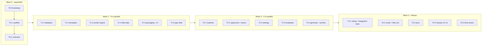

# Sergnanese Social — implementation plan

**Status (2026-11-25):** v0.1.0 is released (Waves 0–3 done); v0.2.0 is tagged. Wave 4 feature work for **v0.2.0 is complete and merged**: T4.2 tuttocampo, T4.3 PDF, T4.5 results workflow (gate findings F2–F5 fixed, see `docs/qa/t4.5-gate.md`), T4.8 CSI Live, T4.9 all opponents, T4.10 opponent matching, T4.11 season import; selection presets in the Tuttocampo review. **Release v0.2.0 done 2026-11-25** (USER-GUIDE, changelog, version, tag); the by-hand T4.5 checks and F6 remain open for the user. **Deferred by the user on 2026-11-25:** T4.1 CSV/Excel to v1.1 (File menu item shown, disabled); T4.6 captions, hashtags and social publishing to a future version, maybe 2.0; T4.4 Shortcuts is frozen (App Intents metadata cannot be generated without Xcode, checked 2026-11-25); T4.7 signing and updates is the focus once the remaining features are done. See `tasks/wave-4-later.md`, section "Where we are".

**Written:** 2026-11-16 · **Revised:** 2026-11-16 (native Mac app instead of Electron) · **Target:** v0.1.0, a Mac app downloadable from GitHub Releases.

## What we are building

A native Mac app that turns the club's weekend fixtures into ready-to-post Instagram and Facebook images.

1. **Match database** — teams, opponents and matches stored locally.
2. **Review and edit** — check and fix the matches of a weekend before anything is generated.
3. **Template manager** — load, preview and manage HTML/CSS templates.
4. **Fill templates** — pick matches by date; opponent name, logo, time, venue and home/away are filled in.
5. **Generate and share** — PNG files at the exact social size (post 1080×1350, story 1080×1920), sent to the phone with AirDrop or the Share menu.

## Decisions already taken

| # | Decision | Source |
|---|---|---|
| D1 | Runs on the user's own Mac. No server, no cloud. | User |
| D2 | Match data in v0.1.0 is entered by hand. Development uses **fake matches** (seed data). | User |
| D3 | Import (CSV/Excel, website scraping, PDF) comes later, in Wave 4. | User |
| D4 | Opponent logos will later be downloaded from tuttocampo.it (T4.2, by direct fetch of the club widgets). In v0.1.0 they are added by hand; seed data uses generated placeholder logos. | User |
| D10 | Teams playing in CSI leagues are imported from CSI Live (`live.centrosportivoitaliano.it`), matches, opponent names and logos, no standings (T4.8). The site runs a Cloudflare bot check, so the app does not fetch it: the user opens the page in an in-app browser window and presses "Importa questa pagina". (Added 2026-11-22.) | User |
| D11 | "Scarica tutti gli avversari…" in Avversari fills the opponent list in one go (T4.9): tuttocampo from each team's Classifica widget, CSI from the team list kept at the last CSI page read (no new CSI request). Review before saving; existing opponents only get a missing logo; possible duplicates are always asked (keep A, keep B, or separate). (Added 2026-11-24.) | User |
| D12 | Every import review arrives with opponents pre-matched (T4.10): an exact match (legal prefixes and suffixes, case, accents and punctuation ignored) is linked; a single close match is proposed and pre-filled; the user only corrects. Confirmed links save the imported name as an alias. (Added 2026-11-24.) | User |
| D13 | "Importa da Tuttocampo…" can read the whole season (T4.11): this weekend (default), from today to the end, or every matchday; one team or all. Pages one at a time, ≥ 1 s apart, capped, only on demand; byes are information; the usual review before saving. (Added 2026-11-24.) | User |
| D5 | Long team names are **truncated** (with a manual short-name override). | User |
| D6 | The app must be downloadable from GitHub as a package and run on the Mac. | User |
| D7 | Review/edit before render is part of v0.1.0. | User |
| D8 | **The app is used on the Mac only.** There is no iPhone browser access. Images reach the phone through AirDrop / the Share menu. (Revised 2026-11-16; replaces "iPhone over Wi-Fi later".) | User |
| D9 | Implementation is done with Claude Code CLI, with parallel subagents. | User |

## Decisions proposed by this plan (change them before Wave 0 if you disagree)

| # | Proposal | Why |
|---|---|---|
| P1 | **Native Mac app in Swift + SwiftUI**, built with Swift Package Manager. No Xcode project. | With D8 there is no reason to carry a web stack. A native app gets menus, Dark Mode, sharing, Quick Look and accessibility from the system, and is a few MB instead of ~100 MB. |
| P2 | Templates are rendered by the system web engine (WebKit, `WKWebView`) in an off-screen view. | No browser to bundle. Checked on this Mac: see "What was verified" below. |
| P3 | SQLite database in the user's Application Support folder, through the GRDB library. | Single file, easy backup, nothing in git. SwiftData is not usable without Xcode (verified). |
| P4 | Templates are folders: `template.html` (Mustache) + `manifest.json` + `assets/`. Each template is self-contained, fonts included. | Simple to write by hand or with Claude, easy to validate. |
| P5 | App UI language: Italian only. | The club's volunteers are Italian speakers. |
| P6 | App is **ad-hoc signed, not notarized**. First launch needs one manual approval in System Settings. | Notarization needs a paid Apple Developer account. See `05-macos-packaging.md`. |
| P7 | **Apple silicon only, macOS 15 or later.** No Intel build. | The user's Mac is Apple silicon on macOS 27. macOS 26 was the last release for Intel Macs. One download, half the packaging work. |
| P8 | Bundle identifier `com.sergnanese.social`. | Matches the club's domain (sergnanese.com). Must not change after release. |

## What was verified on the user's Mac (2026-11-16)

The Mac has the Xcode Command Line Tools only (Swift 6.4.2), not Xcode. These were run as throwaway experiments, outside the repo:

| Check | Result |
|---|---|
| SwiftUI + AppKit + `@Observable` build with `swift build` | Works |
| Swift Testing (`swift test`) | Works |
| SwiftData `@Model` | **Does not build** without Xcode (macro plugin missing). Not used. |
| GRDB 7.12, swift-mustache 2.1, ZIPFoundation 0.9.20 | Resolve and build; a Mustache `{{#rows}}` / `{{^logo}}` template renders correctly |
| `Post · Pre-partita` demo rendered by an off-screen `WKWebView` | PNG of exactly 1080×1350 on a Retina display; the accent pixel reads exactly `#CF3326` |
| `iconutil`, `hdiutil`, `codesign`, `ditto`, `swift format` | Present |
| `actool` (compiles the new layered `.icon` format) | **Missing** without Xcode. The icon is a classic `.icns`. |

Not yet verified: the same build and render on a GitHub macOS runner. T1.5 proves it.

## Files in this plan

| File | What it holds |
|---|---|
| `01-architecture.md` | Stack, folder layout, data model, contracts, template format, render pipeline |
| `02-agents-and-models.md` | Which model for which kind of task, the agent roster, escalation rules |
| `03-mac-design.md` | How the app looks and behaves as a Mac app: window, sidebar, menus, shortcuts, sharing, accessibility |
| `tasks/wave-0-foundation.md` | Sequential foundation tasks (scaffold, contracts) |
| `tasks/wave-1-core.md` | 6 tasks that run in parallel |
| `tasks/wave-2-features.md` | 5 tasks that run in parallel |
| `tasks/wave-3-release.md` | Integration, QA, first release |
| `tasks/wave-4-later.md` | Import, scraping, results workflow, signing |
| `04-execution-guide.md` | How to run each wave in Claude Code CLI, with copy-paste prompts |
| `05-macos-packaging.md` | Building the Mac app on GitHub: what works, limits, install steps |
| `agents/*.md` | Ready-to-use subagent definitions (copied to `.claude/agents/` in task T0.0) |
| `CLAUDE.template.md` | Project instructions (copied to `CLAUDE.md` in task T0.0) |

## Waves at a glance

| Wave | Tasks | Parallel | Haiku | Sonnet | Opus |
|---|---|---|---|---|---|
| 0 Foundation | 3 | no | 0 | 1 | 1 (+ T0.0 in main session) |
| 1 Core | 6 | yes, all 6 | 1 | 4 | 1 |
| 2 Features | 5 | yes, all 5 | 0 | 5 | 0 |
| 3 Release | 5 | partly | 1 | 2 | 2 |
| **Total v0.1.0** | **19** | | **2** | **12** | **4** |

Fable, the most capable and most expensive model, is not assigned to any task. It is the last step of the escalation ladder in `02-agents-and-models.md`.

## How to start

1. Merge this plan into `main`. Subagent worktrees branch from the default branch, so the plan and the agent files must be there.
2. Read `04-execution-guide.md`.
3. Run task **T0.0** (one command), then Wave 0.

## Inputs still needed from the user

| Needed for | Input |
|---|---|
| T1.5 | The club crest as a vector file (SVG/PDF) or a PNG of at least 1024×1024. The one inside the demo zips is 500×500, too small for a sharp app icon. Without it the icon is upscaled and slightly soft. |
| T1.4 (nice to have) | Real list of the club's teams/categories. Fake ones are used otherwise. |
| T4.2 | A check of tuttocampo.it's terms of use for automated reading, and confirmation of which widget ID belongs to which team. The six widget IDs are already known (see the T4.2 sheet). |
| T4.1 | Deferred to v1.1 (2026-11-25), no input needed now. |
| T4.6, T4.4, T4.7 | T4.6 deferred (maybe 2.0); T4.4 frozen (needs Xcode); T4.7 needs a paid Apple Developer account, focus after the remaining features. |
| T4.3 | Sample received (`examples/Calendario_EsordientiMiste_Femm_Aut.pdf`, keep it out of git). Still wanted: a spring-phase PDF (`R.` dates) of the same layout. |
| T4.10 | Which tuttocampo widget shows the U13 femminile girone of the federation calendar: widget `e6c85afd…` (mapped to "U13 Regionale Femminile") shows a different girone; only Cremonese is in both. |
| T4.11 | The tuttocampo terms check (T4.2) must also allow reading every matchday of a team (~30 requests per team per run). |
| T4.8 | A check of CSI Live's terms of use; each CSI girone page saved from Safari ("Archivio web" and "Sorgente pagina") into a folder outside the repo; which club team each CSI page belongs to. |
