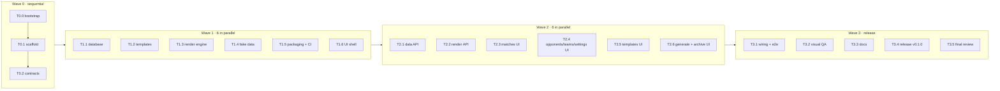

# Sergnanese Social — implementation plan

**Status:** plan only. No application code exists yet. The repo holds this plan and the four demo templates in `template-demo/`.

**Written:** 2026-11-16 · **Target:** v0.1.0, a Mac app downloadable from GitHub Releases.

## What we are building

A desktop app for the Mac that turns the club's weekend fixtures into ready-to-post Instagram and Facebook images.

1. **Match database** — teams, opponents and matches stored locally.
2. **Review and edit** — check and fix the matches of a weekend before anything is generated.
3. **Template manager** — load, preview and manage HTML/CSS/JS templates.
4. **Fill templates** — pick matches by date; opponent name, logo, time, venue and home/away are filled in.
5. **Generate and save** — PNG files at the exact social size (post 1080×1350, story 1080×1920).

## Decisions already taken

| # | Decision | Source |
|---|---|---|
| D1 | Runs on the user's own Mac. No server, no cloud. | User |
| D2 | Match data in v0.1.0 is entered by hand. Development uses **fake matches** (seed data). | User |
| D3 | Import (CSV/Excel, website scraping, PDF) comes later, in Wave 4. | User |
| D4 | Opponent logos will later be downloaded from tuttocampo.it. In v0.1.0 they are uploaded by hand; seed data uses generated placeholder logos. | User |
| D5 | Long team names are **truncated** (with a manual short-name override). | User |
| D6 | The app must be downloadable from GitHub as a package and run on the Mac. | User |
| D7 | Review/edit before render is part of v0.1.0. | User |
| D8 | iPhone use is wanted, but after the Mac app works (Wave 4, over the home Wi-Fi). | User + plan |
| D9 | Implementation is done with Claude Code CLI, with parallel subagents. | User |

## Decisions proposed by this plan (change them before Wave 0 if you disagree)

| # | Proposal | Why |
|---|---|---|
| P1 | **Electron** desktop app. | It ships its own Chromium, so templates render to PNG inside the app with no extra browser to install. It packages to a `.dmg` on GitHub Actions. |
| P2 | One local HTTP API (Fastify) inside the app; the window and, later, the iPhone both use it. | One code path for Mac and iPhone. |
| P3 | SQLite database in the user's Application Support folder. | Single file, easy backup, nothing in git. |
| P4 | Templates are folders: `template.html` (Handlebars) + `manifest.json` + `assets/`. | Simple to write by hand or with Claude, easy to validate. |
| P5 | App UI language: Italian, with all strings in one file. | The club's volunteers are Italian speakers. |
| P6 | App is **ad-hoc signed, not notarized**. First launch needs one manual approval in System Settings. | Notarization needs a paid Apple Developer account. See `05-macos-packaging.md`. |

## Files in this plan

| File | What it holds |
|---|---|
| `01-architecture.md` | Stack, folder layout, data model, contracts, template format, render pipeline |
| `02-agents-and-models.md` | Which model for which kind of task, the agent roster, escalation rules |
| `tasks/wave-0-foundation.md` | Sequential foundation tasks (scaffold, contracts) |
| `tasks/wave-1-core.md` | 6 tasks that run in parallel |
| `tasks/wave-2-features.md` | 6 tasks that run in parallel |
| `tasks/wave-3-release.md` | Integration, QA, first release |
| `tasks/wave-4-later.md` | Import, scraping, iPhone, results workflow |
| `04-execution-guide.md` | How to run each wave in Claude Code CLI, with copy-paste prompts |
| `05-macos-packaging.md` | Building the Mac app on GitHub: what works, limits, install steps |
| `agents/*.md` | Ready-to-use subagent definitions (copied to `.claude/agents/` in task T0.0) |
| `CLAUDE.template.md` | Project instructions (copied to `CLAUDE.md` in task T0.0) |

## Waves at a glance

| Wave | Tasks | Parallel | Haiku | Sonnet | Opus |
|---|---|---|---|---|---|
| 0 Foundation | 3 | no | 0 | 1 | 1 (+ T0.0 in main session) |
| 1 Core | 6 | yes, all 6 | 1 | 4 | 1 |
| 2 Features | 6 | yes, all 6 | 1 | 5 | 0 |
| 3 Release | 5 | partly | 1 | 2 | 2 |
| **Total v0.1.0** | **20** | | **3** | **12** | **4** |

Fable, the most capable and most expensive model, is not assigned to any task. It is the last step of the escalation ladder in `02-agents-and-models.md`.

## How to start

1. Merge this plan into `main`. Subagent worktrees branch from the default branch, so the plan and the agent files must be there.
2. Read `04-execution-guide.md`.
3. Run task **T0.0** (one command), then Wave 0.

## Inputs still needed from the user

| Needed for | Input |
|---|---|
| T1.4 (nice to have) | Real list of the club's teams/categories. Fake ones are used otherwise. |
| T4.2 | The tuttocampo.it page address for each team, and a check of that site's terms of use. |
| T4.1 / T4.3 | A sample fixture document (Excel/CSV/PDF). |
